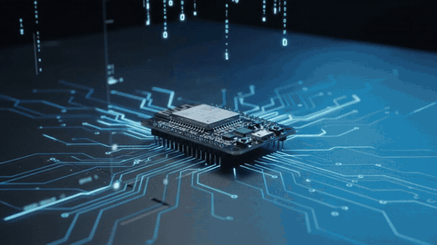

# ESP32 Local AI Chatbot

**Osiris: an ESP32-S3 voice assistant with standalone cloud and host-assisted modes.**



10-second animated preview (silent). [Open or download the original MP4 with audio](https://github.com/johntsaiainow/ESP32-Local-Ai-Chatbot/raw/refs/heads/main/docs/media/osiris-promotion.mp4).

Board targets now include BOX-3, LiChuang 实战派 SZPI ESP32-S3, CoreS3,
AtomS3R + Echo Base, and basic CrowPanel 7″ + external INMP441. New ports await
physical hardware validation; see
[board selection, build commands and limitations](docs/boards.md).
CrowPanel microphone wiring and its 4 MB flash layout are covered in the
[CrowPanel guide](docs/crowpanel7.md).

Use the BOX-3 on its own with OpenAI or Gemini over Wi-Fi, or connect it over
USB/TCP to a Linux/macOS host for Pi coding-agent integration and local speech
processing. Both modes provide microphone capture, speaker playback,
multilingual text, and Osiris color emoji expressions. The language model runs
on the provider or configured host backend, rather than on the ESP32 itself.

## Supported hardware

| ESP32-S3-BOX-3 | LiChuang 实战派 ESP32-S3 | M5Stack CoreS3 |
| --- | --- | --- |
| [](docs/boards.md#espressif-esp32-s3-box-3) | [](docs/boards.md#lichuang-实战派-esp32-s3) | [](docs/boards.md#m5stack-cores3) |
| `esp32s3box3` | `lichuang_s3` | `cores3` — photo shows SE variant; see note below |

| AtomS3R + Atomic Echo Base | CrowPanel 7″ + external INMP441 |
| --- | --- |
| [](docs/boards.md#atoms3r--atomic-echo-base) | [](docs/crowpanel7.md) |
| `atoms3r_echo` — Echo Base required | `crowpanel7_inmp441` — microphone not shown |

Product photos illustrate the hardware; their screen contents are not Osiris UI.
The supplied CoreS3 photo is labeled **CoreS3 SE**; the documented target is
CoreS3, and this photo does not establish SE compatibility. See the
[board guide](docs/boards.md) for exact models and validation limits, and the
[CrowPanel guide](docs/crowpanel7.md) for required microphone wiring.

## Features

- **ESP32-S3-BOX-3 interface:** built-in display, microphone, speaker, and audio-level meter.
- **Multilingual display:** English, Simplified Chinese, Traditional Chinese, Japanese, and Korean using bundled 16-pixel LovyanGFX efonts.
- **Color emoji avatar:** LovyanGFX-rendered Noto emoji with a supported subset of inline icons and 13 state expressions, including sleeping while waiting for the wake phrase.
- **USB or Wi-Fi transport:** display text, capture microphone audio, and play host-generated PCM audio; show the active transport and switch without losing the Pi session.
- **Configurable wake phrase:** choose your phrase in Settings (default “Osiris”), with a 15-second initial request window and 30-second follow-up window after each reply.
- **WiFi Manager:** saved Wi-Fi credentials, automatic setup hotspot on startup connection failure, and an on-screen Settings button.
- **Offline speech processing:** faster-whisper for speech-to-text, OpenCC for Traditional Chinese conversion, and Piper for text-to-speech.
- **Standalone cloud voice:** configure OpenAI or Gemini on the device; record, transcribe, chat, and speak without a Python host.
- **OpenClaw integration:** connect the ESP32 directly to your Gateway over Wi-Fi, or use host-side local speech. See [setup and connection options](docs/openclaw.md).
- **Host-assisted providers:** Pi coding agent by default, with optional OpenAI/Gemini/OpenClaw text adapters in the host script.
- **Pi coding-agent integration:** optional Pi extension tools and a standalone conversational voice agent.
- **Local music playback:** decode files from a local music directory with mpv and stream them to the BOX-3 speaker.
- **Lower voice latency:** streamed model text, sentence speech queues, PCM playback during download, persistent Pi RPC, startup Piper warmup, and per-stage timing logs. See [latency settings and measurement](docs/voice-latency.md).
- **Robust audio transport:** offset and CRC32 validation, retries, synchronization, and PSRAM-buffered continuous playback on compatible firmware.
- **Linux-first workflow:** PlatformIO, Python virtual environments, and terminal-based diagnostics.

## System architecture

Standalone mode:

```text
BOX-3 microphone → Wi-Fi HTTPS → OpenAI / Gemini
BOX-3 speaker    ← Wi-Fi HTTPS ← cloud speech synthesis
```

Host-assisted mode:

```text
ESP32-S3-BOX-3                    Linux / macOS host
┌─────────────────────┐          ┌─────────────────────────────┐
│ Microphone + I2S    │ ───────▶ │ host/box3.py               │
│ LCD + color emoji  │ ◀─────── │ host/voice_agent.py         │
│ Speaker + I2S      │ ◀─────── │ STT → wake gate → Pi → TTS │
└─────────────────────┘          │ Local music (mpv/ffmpeg)   │
          USB or Wi-Fi TCP:8233   └─────────────────────────────┘
```

In host-assisted mode the device captures audio and displays responses; the host performs recognition, agent execution, speech generation, and optional music decoding. Recording and playback are sequential; this is not a full-duplex echo-canceling voice system.

## Hardware and software

| Component | Requirement |
| --- | --- |
| Device | BOX-3; LiChuang S3, CoreS3, AtomS3R + Echo Base and CrowPanel 7 + INMP441 ports ([details](docs/boards.md)) |
| Firmware | Arduino framework via PlatformIO / pioarduino |
| Display library | LovyanGFX; M5GFX/M5Unified on M5Stack ports |
| Host | Optional for standalone cloud; Linux/macOS for host-assisted operation |
| Connection | Internet Wi-Fi for standalone cloud; USB or LAN TCP:8233 for host mode |
| Power | USB power is still required during Wi-Fi operation |
| Host runtime | Python 3, virtual environment; Pi CLI only for the Pi backend |
| Speech | faster-whisper, OpenCC, Piper voice models |
| Music | mpv; ffmpeg alternative |
| Audio format | 16 kHz, mono, signed 16-bit PCM WAV |

BOX-3, LiChuang S3 and CoreS3 use **16 MB flash layouts**. AtomS3R uses an
**8 MB layout with one application slot** to fit bundled fonts. Basic CrowPanel
7″ uses a **4 MB layout with one application slot and no filesystem**. Flashing a new
partition table may make existing filesystem contents incompatible.

## Repository layout

```text
ESP32-Local-Ai-Chatbot/
├── src/                  # ESP32 firmware and selected emoji assets
├── host/                 # USB/TCP client, speech adapters, voice agent
│   ├── README.md         # Detailed host setup and protocol reference
│   ├── box3.py           # Host-side device control
│   ├── voice_agent.py    # Standalone voice conversation loop
│   └── offline_speech.py # Speech recognition and synthesis CLI
├── pi/                   # Pi coding-agent extension
│   └── box3.ts
├── tests/                # Host, protocol, wake-word, and TCP tests
├── third_party/          # Emoji attribution and upstream licenses
├── docs/boards.md        # Board selection, flashing and hardware validation
├── platformio.ini        # Board-specific PlatformIO environments
└── README.md
```

## Quick start

For operation without host scripts, build/flash step 1 and follow
[Standalone OpenAI / Gemini voice](#standalone-openai--gemini-voice--no-python-host).
The remaining host setup steps are optional in that mode.

### 1. Clone and build firmware

Install [PlatformIO Core](https://docs.platformio.org/en/latest/core/installation/index.html), then:

```bash
git clone https://github.com/johntsaiainow/ESP32-Local-Ai-Chatbot.git
cd ESP32-Local-Ai-Chatbot
pio run
pio run --target upload
```

These commands default to BOX-3. For other boards, specify `-e lichuang_s3`,
`-e cores3`, `-e atoms3r_echo` or `-e crowpanel7_inmp441` for both build and upload. See the
[board guide](docs/boards.md) before flashing; images are specific to each board.

To inspect boot and hardware diagnostics:

```bash
pio device monitor --baud 115200
```

**Close the serial monitor before starting the host bridge.** Only one application should own the USB serial port at a time.

### 2. Set up the host bridge

```bash
python3 -m venv host/.venv
host/.venv/bin/pip install -r host/requirements.txt
export BOX3_PYTHON="$PWD/host/.venv/bin/python"
export BOX3_PORT=/dev/ttyACM0
```

Change `BOX3_PORT` to the actual device path. To discover ports:

```bash
"$BOX3_PYTHON" -m serial.tools.list_ports
```

Check device status, render text, and test audio:

```bash
"$BOX3_PYTHON" host/box3.py status
"$BOX3_PYTHON" host/box3.py display --language en -- 'Pi is ready!'
"$BOX3_PYTHON" host/box3.py display --language zh -- '你好 🤖 ✅'
"$BOX3_PYTHON" host/box3.py record /tmp/box3-mic.wav --seconds 5
"$BOX3_PYTHON" host/box3.py play /tmp/box3-mic.wav
"$BOX3_PYTHON" host/box3.py speaker-test
```

The speaker test generates a one-second 440 Hz tone. A codec-ready status alone does not prove the physical speaker or microphone works; verify with real recording and playback.

### 3. Enable offline speech

Install the additional Python dependencies and system audio utilities:

```bash
sudo apt install ffmpeg mpv
"$BOX3_PYTHON" -m pip install -r host/requirements-offline.txt
```

The default faster-whisper multilingual model is downloaded on first use and cached for later offline recognition. **Piper ONNX voices and their matching `.onnx.json` files must be installed separately**; voice models are not bundled with this repository. The host guide documents the default voice locations and environment overrides.

After configuring Pi CLI and the Piper voices, start the standalone agent:

```bash
"$BOX3_PYTHON" host/voice_agent.py --language auto
```

Useful alternatives:

```bash
"$BOX3_PYTHON" host/voice_agent.py --language zh
"$BOX3_PYTHON" host/voice_agent.py --language zh --silence 1.5
"$BOX3_PYTHON" host/voice_agent.py --keyboard-only
```

`--language auto` supports English/Chinese recognition and mixed utterances. The device-side capture mode uses an amplitude threshold and silence detection, not a neural VAD model. Type `/quit` to exit the voice agent.

### 4. Configure Wi-Fi and transport switching

For USB operation, keep using `BOX3_PORT` from step 2. Wi-Fi setup is optional.

#### Wi-Fi setup / Setting Mode

Tap **Settings** at the bottom right of the touchscreen to enter Setting Mode.
Connect a phone or computer to the **BOX3-Setup-XXXX** hotspot shown on the
display (password: **box3setup**), then open **http://192.168.4.1** if the
configuration page does not appear automatically. Select your Wi-Fi network,
enter its password, and save. Credentials are stored on the device and reused
after restart; no source-code credentials are required.

At startup the device tries the saved network for 15 seconds before opening
the setup hotspot. Successful configuration closes the portal. Tap **Exit**
to close it manually; it also times out after 3 minutes. Settings can reopen
the portal without erasing the saved network. The footer shows the station IP
when connected, or the setup hotspot and password while configuring.

The portal uses [WiFiManager](https://github.com/tzapu/WiFiManager).
Settings input and portal processing may be delayed during synchronous
recording/playback commands or a Wi-Fi connection attempt.

#### Connect Pi Coding Agent over Wi-Fi

Flash the updated firmware first. Connect BOX-3 and the computer running Pi CLI
to the same LAN, then use the BOX-3 IP shown in the display footer:

```bash
host/.venv/bin/python host/voice_agent.py --host 192.168.1.50 --language auto
```

Replace the example IP with your device's IP. The host connects to BOX-3 TCP
port **8233**; the existing speech recognition, Pi CLI conversation session,
reply display, speech synthesis, and music playback work over this connection.
The computer still needs the host speech dependencies, voice models, and Pi CLI
setup described below. BOX-3 only needs USB power during Wi-Fi operation.

Alternatively, set `BOX3_HOST=192.168.1.50`. Explicit `--host` or `--port`
overrides environment defaults; `BOX3_HOST` takes precedence over `BOX3_PORT`.
Use `--port /dev/ttyACM0` to select USB explicitly. Diagnostic commands also
accept `--port socket://192.168.1.50:8233`, for example:

```bash
host/.venv/bin/python host/box3.py --port socket://192.168.1.50:8233 status
host/.venv/bin/python host/box3.py --port socket://192.168.1.50:8233 speaker-test
```

To enable switching during the same Pi conversation, supply both endpoints:

```bash
host/.venv/bin/python host/voice_agent.py --port /dev/ttyACM0 --host 192.168.1.50 --transport wifi
```

The display footer shows **Via: USB** or **Via: WiFi**, independently of Wi-Fi
network connection status. When both endpoints are configured and Wi-Fi is
connected, tap **Switch** beside Settings. A pending indicator remains until
the host switches at the next completed conversation/recording/playback boundary.
You can also type `/transport usb`, `/transport wifi`, or `/transport status` in
the host terminal. Only the selected transport is opened at a time. The Pi session
is preserved, and a failed switch attempts to restore the previous connection.
Both endpoints must refer to the same BOX-3. Switching requires updated firmware
advertising `link=1`; a single endpoint remains compatible with older firmware.
An endpoint being configured does not guarantee that its cable/network is reachable.
With no `--transport`, an explicit `--host` selects Wi-Fi, an explicit `--port`
selects that port, and environment defaults prefer `BOX3_HOST` over `BOX3_PORT`.

One TCP controller owns the device while connected; competing TCP clients are
rejected and USB commands are discarded during that connection. Disconnecting
releases audio buffers and restores USB control. If a connection fails, restart
the host command after connectivity returns. The TCP protocol has no authentication
or encryption and is intended for a trusted local network; do not expose port
8233 to the internet.

### 5. Optional Pi extension

For direct Pi tool access instead of the standalone voice-agent loop:

```bash
pi -e ./pi/box3.ts
```

The extension exposes:

| Tool | Purpose |
| --- | --- |
| `box3_display` | Show multilingual text and supported emoji |
| `box3_say` | Synthesize speech on the host and play through BOX-3 |
| `box3_listen` | Capture and transcribe an English or Chinese utterance |

Within Pi, `/box-listen en` or `/box-listen zh` records an utterance and submits the transcript. The standalone voice agent and Pi USB extension **must not access the same serial port simultaneously**.

## OpenClaw voice agent

Select `openclaw` in **Settings → Setup** and enter your Gateway URL, token and
agent ID. The ESP32 connects directly; speech recognition and synthesis still
use an OpenAI API key. For local Whisper/Piper speech, use the optional host
script with `--provider openclaw`. See the [OpenClaw guide](docs/openclaw.md) for
Gateway configuration, required fields and commands.

## Standalone OpenAI / Gemini voice — no Python host

The BOX-3 can connect directly to OpenAI or Gemini using its own Wi-Fi and verified
HTTPS. In this mode no Python script, Pi CLI, PC speech model, or host service
is needed at runtime. The device records microphone audio, requests cloud
transcription, obtains a conversational reply, requests cloud speech, and plays
it through its built-in speaker. USB is only needed for flashing and power.

1. Flash the updated firmware with `pio run --target upload`.
2. Tap **Settings**, connect to the displayed `BOX3-Setup-XXXX` hotspot
   (password `box3setup`), and open **http://192.168.4.1**.
3. Use **Configure WiFi** to join an internet-connected network.
4. Open **Setup** in the portal and fill in the fields below, then **Save**.
5. Exit the portal. Wait for Wi-Fi/network time, then say **“Osiris!”**.
   Speak your question after the listening state appears, or include the question
   after the wake word. After each spoken answer, Osiris accepts follow-ups for
   30 seconds without another wake word.

| Portal field | OpenAI | Gemini |
| --- | --- | --- |
| Mode | `openai` | `gemini` |
| OpenAI / Gemini API key | Fill the OpenAI field | Fill the Gemini field |
| Chat model ID | A model supporting Responses text generation | A Generate Content model supporting text and inline WAV audio |
| OpenAI transcription model | Defaults to `gpt-4o-mini-transcribe`; change if needed | Not used; the chat model transcribes audio |
| Speech model ID | A model supporting `/v1/audio/speech` with PCM output | A Gemini TTS model supporting Generate Content audio output |
| Voice | Blank defaults to `alloy` | Blank defaults to `Kore` |

Choose chat and speech model IDs enabled for your API account; these fields are
required and are separate because a chat model is not necessarily a speech model.
OpenAI and Gemini keys are saved separately. Leaving a key field blank keeps its
saved value; enter `-` to clear it. Saved keys are never filled back into the
portal or printed to serial. Settings persist in device NVS across restarts;
NVS encryption is not configured by this project. Provision credentials through
the device hotspot on a trusted connection.

The footer identifies the direct provider. Change Mode back to **`host`** to use
the existing USB/TCP Python/Pi workflow. The default remains `host`, so flashing
alone does not start cloud requests. Host audio commands are unavailable while
standalone mode owns the microphone/speaker. Switching modes clears the direct
conversation, which otherwise retains four completed turns in RAM.

Standalone wake matching uses **cloud transcription**, not an on-device trained
keyword model. While standalone mode is selected, speech detected by the local
amplitude gate is uploaded even while waiting for the wake word. Transcription,
chat, and speech use your provider account and quota. Questions and conversation
context also go to that provider. Listening pauses during HTTP requests and
playback. Recordings are limited to ten seconds; replies are requested to be
short. Model text streams into a sentence speech queue. OpenAI speech and
Gemini TTS 3.1+ play while downloading; older Gemini speech buffers each sentence.
The microphone is paused during replies. See [voice latency and timing logs](docs/voice-latency.md).
The Settings portal is paused during blocking cloud requests and playback.

TLS uses the ESP32 framework CA bundle and network time; certificate verification
is enabled. A blocked NTP connection, invalid model/key, exhausted quota, or API
error appears on the display. PSRAM and working microphone/speaker initialization
are required. Direct mode has no Pi coding tools, filesystem tools, live weather
lookup, or host music playback.

Implementation references:
[OpenAI transcription](https://developers.openai.com/api/docs/guides/speech-to-text),
[OpenAI speech](https://developers.openai.com/api/docs/guides/text-to-speech),
[Gemini audio input](https://ai.google.dev/gemini-api/docs/generate-content/audio), and
[Gemini speech output](https://ai.google.dev/gemini-api/docs/generate-content/speech-generation).
Build and helper checks do not replace live API and real-device validation.

## Experimental ChatGPT subscription adapter

The firmware now has an **experimental `chatgpt` mode** for subscription-authorized
text inference using separately imported OAuth credentials. It does **not** provide
a working first-time browser login on ESP32. A valid app/device-specific OAuth
registration must already have been provisioned through the official sign-in
flow. This prototype is not a claim that the ESP32 loopback-login limitation has
been solved. No account has been connected or live subscription request verified.

In **Settings → Setup**:

1. Set Mode to `chatgpt`.
2. In **OAuth JSON**, import credentials issued for this app/device. Do not use
   another application's bundled client ID, account password, browser cookie,
   or credentials belonging to someone else. Do not paste actual tokens into chat
   or commit them to this repository.
3. Keep an **OpenAI API key** and valid transcription/speech model IDs for audio.
   The OAuth credential is used only for text Responses requests.
4. Set an available subscription chat model ID, or leave Chat model blank to
   select the first visible model in the account-specific catalog.
5. Save and exit. The device verifies access through the provider's model and
   inference endpoints; errors appear on screen. API voice calls still incur API
   usage even if subscription inference subsequently fails.

The import accepts a JSON object containing `access_token`, `refresh_token`, and
an issued `client_id` beginning with `oaiapp_`. Optional `expires_at` and
`earliest_refresh_at` are Unix timestamps; include them from your provisioning
record when available. `scope` may be a space-separated string or `scopes` an
array. Missing expiry triggers a refresh before use. Placeholder-only example:

```json
{
  "client_id": "oaiapp_YOUR_DEVICE_REGISTRATION",
  "access_token": "YOUR_OWN_APP_ACCESS_TOKEN",
  "refresh_token": "YOUR_OWN_APP_REFRESH_TOKEN",
  "scope": "offline_access resource.invoke chatgpt.tokens.use.direct",
  "expires_at": 0,
  "earliest_refresh_at": 0
}
```

The import is a bearer-credential provisioning interface, not an OIDC account
sign-in: it does not trust or display imported identity claims or use ID tokens.
The model/inference server authorizes imported access tokens; refreshed scopes
are checked for ChatGPT plan grants. Tokens are saved together in NVS, including
rotating refresh tokens, without being echoed into the portal. Blank preserves
the record; enter `-` to sign out locally. NVS encryption is not enabled.

Text inference uses streaming Responses requests with `store=false` and
`stream=true`, a bounded SSE decoder, and the existing four-turn device history.
The device refreshes access when needed, checks the account model catalog, and
rejects incomplete/error streams. **It never silently falls back to paid API
chat** if subscription access fails. Speech stays on the existing OpenAI API
transcription and synthesis path. Gemini remains in its API mode; Google-account
subscription login is not implemented on the ESP32.

The official ChatGPT open-source sign-in flow still requires a callback listener
at `127.0.0.1` on the browser's machine. A phone browser points that address at
the phone, not BOX-3. External initial provisioning remains necessary for this
experimental import path; no Python or Node.js service runs during inference.

Google AI Pro / Ultra subscribers may have eligible monthly developer credits.
To use those benefits with the existing **standalone Gemini API mode**:

1. In a browser, sign in with the subscribed Google account and activate its
   eligible Google Developer Program benefits.
2. Follow AI Studio billing setup for the project that will issue the Gemini
   API key. Confirm that the specific credits are eligible and applied to that
   project's billing account. Prepay accounts require an active prepaid balance
   before eligible promotional Cloud credits can be consumed.
3. Create the project's Gemini API key and enter it in the BOX-3 Setup page,
   with Mode `gemini` and suitable chat/speech model IDs.
4. Run the device directly; no Python or Node.js service is required.

This uses the API project's billing and eligible credits, not Gemini app chat
quota. Benefits and credit eligibility depend on the account/plan; firmware
cannot activate benefits, inspect subscription status, or guarantee zero API
charges. Google account login for the Gemini CLI is a separate route and is not
ported into this firmware. First-time ChatGPT sign-in remains unavailable on this firmware; the experimental
adapter only operates after separate, valid app-specific credential provisioning.
Ordinary OpenAI API mode stays available.

Official references: [ChatGPT registration and loopback callback](https://developers.openai.com/siwc/token-sharing-open-source/sign-in),
[ChatGPT plan limitations](https://developers.openai.com/siwc/token-sharing-open-source/preview-limitations),
[Gemini CLI Google authentication](https://geminicli.com/docs/get-started/authentication/),
[Google subscription developer benefits](https://blog.google/innovation-and-ai/technology/developers-tools/gdp-premium-ai-pro-ultra/),
and [Gemini API credit billing](https://ai.google.dev/gemini-api/docs/billing).

## Optional host-script reply providers

Pi remains the default. The standalone voice agent can also request text replies
from OpenAI or Gemini directly, without installing or launching Pi CLI. Speech
recognition, wake gating, synthesis, music decoding, and device transport still
run on the host. The 30-second follow-up window applies to every provider.

| Provider | Startup option | Host credential | Model configuration |
| --- | --- | --- | --- |
| Pi CLI | `--provider pi` (default) | Existing Pi configuration | Existing Pi configuration |
| OpenAI | `--provider openai` | `OPENAI_API_KEY` | `--model` or `BOX3_OPENAI_MODEL` |
| Gemini | `--provider gemini` | `GEMINI_API_KEY` | `--model` or `BOX3_GEMINI_MODEL` |

Choose a model ID available to your API account. No cloud model is hardcoded.
Set the relevant key in your host environment, then start one provider:

```bash
# OpenAI — replace both placeholders with your own values.
export OPENAI_API_KEY='YOUR_OPENAI_API_KEY'
export BOX3_OPENAI_MODEL='YOUR_OPENAI_MODEL_ID'
host/.venv/bin/python host/voice_agent.py --host 192.168.1.50 --provider openai

# Gemini — use this instead to select Gemini.
export GEMINI_API_KEY='YOUR_GEMINI_API_KEY'
export BOX3_GEMINI_MODEL='YOUR_GEMINI_MODEL_ID'
host/.venv/bin/python host/voice_agent.py --host 192.168.1.50 --provider gemini
```

Use your actual BOX-3 IP, or replace `--host` with `--port /dev/ttyACM0` for USB.
An explicit `--model MODEL_ID` overrides the selected provider's model environment
variable. For keyboard prompts, add `--keyboard-only`; speech playback still uses
the existing local voices. No extra Python SDK or firmware update is required.

The terminal identifies the selected provider and model, and cloud replies are
labeled OpenAI or Gemini on the display. Cloud conversations retain the most
recent 12 completed turns in host memory and reset when the process restarts.
Switching USB/Wi-Fi does not reset that history. Failed, blocked, or empty
responses do not add a turn.

Direct cloud providers return conversational text; they do not receive Pi's
coding tools, filesystem access, or web/weather tools. Explicit `/music` and
supported local song requests continue to be handled by the host. Cloud mode
sends recognized request text and recent conversation history to the selected
provider over HTTPS, and requires internet access and an API account with model
access/quota. API keys stay in the host environment and are not sent to BOX-3.
Keep real credentials out of committed files. STT/TTS audio is still processed
locally by the existing pipeline.

The adapters use OpenAI's [Responses API](https://developers.openai.com/api/docs/guides/text)
and Gemini's [Generate Content API](https://ai.google.dev/gemini-api/docs/generate-content/text-generation).
For HTTP authentication, model-access, quota, or rate-limit errors, check the
selected API account and model ID. No live cloud calls are made by the tests.

## Configurable wake phrase

Spoken requests require **Osiris** by default in the host voice agent and standalone cloud mode:

To change it on any supported board:

1. Open **Settings → Setup** using the touchscreen or the board's Settings button.
2. Enter **Wake phrase**, for example `Hey Nova`, `小智`, or `ねえオシリス`.
3. Save and exit Settings. The value survives reboot; blank restores `Osiris`.

Use at most **96 UTF-8 bytes** (up to 32 Chinese/Japanese characters); quotes
and `< > &` are not accepted in the portal. Surrounding sentence punctuation is
removed. English matching ignores case; non-ASCII text must match the transcript.
Choose a phrase your speech recognizer transcribes consistently.

Standalone OpenAI, Gemini and experimental subscription modes use the saved
phrase immediately. The updated host agent reads it between listening turns
and refreshes its wake prompt when it changes. A phrase change closes the old
follow-up window. `--wake-word` overrides the device setting for that host run;
`--no-wake-word` still disables host wake gating. Older firmware defaults to
`Osiris` and supports the existing host override. Flash updated firmware and
restart the updated host script to use shared device settings.

- Say **“Osiris, what is the weather?”** in one utterance, or
- Say **“Osiris!”**, wait for **Awake!** on the display, then speak one request
  within **15 seconds**.

After each completed answer, the agent stays awake for **30 seconds** so you
can ask a follow-up without repeating “Osiris!”. Each completed reply starts a
fresh 30-second window. If the window expires, the sleeping emoji returns and
the wake phrase is required again. The standalone wake still allows 15 seconds
for the first request. Unrelated speech is ignored while asleep. Keyboard prompts and `/transport` commands do not need a wake phrase.
The default spelling is **Osiris**; the exclamation mark is optional.
Substitute your saved phrase in the examples below.

```bash
host/.venv/bin/python host/voice_agent.py --host 192.168.1.50 --language auto
# Optional: change initial/follow-up timeouts, keyword, or disable wake gating
host/.venv/bin/python host/voice_agent.py --host 192.168.1.50 --followup-timeout 30
host/.venv/bin/python host/voice_agent.py --host 192.168.1.50 --wake-timeout 20
host/.venv/bin/python host/voice_agent.py --host 192.168.1.50 --wake-word 'Hey Osiris'
host/.venv/bin/python host/voice_agent.py --host 192.168.1.50 --no-wake-word
```

In host mode, wake detection uses the existing host speech-to-text transcript, rather than a
separate trained keyword model. Standalone mode uses the cloud transcription described above. Audio still travels to the host and is recognized
while waiting; requests only go to Pi after the wake phrase matches. Recognition
accuracy and wake response time depend on the speech model and language setting;
`--language auto` allows the English wake phrase with Chinese or English requests.
It listens between requests, and remains paused during Pi processing and speaker
playback. Wake phrases are matched against transcription; changing the setting
does not train an on-device neural wake-word model.

## Multilingual display and emoji

Firmware provides `printLocalizedText(x, y, text, language)` with the following language options:

- `English`
- `SimplifiedChinese`
- `TraditionalChinese`
- `Japanese`
- `Korean`

Example:

```cpp
printLocalizedText(10, 100, "\uC548\uB155\uD558\uC138\uC694",
                   DisplayLanguage::Korean);
printLocalizedText(10, 10, "Agent ready \U0001F916 \u2705",
                   DisplayLanguage::English);
```

Supported inline icons use 16×16 color PNGs from LGFX_Fonts: selected faces, ear, robot, microphone, speaker, check, cross, warning, and heart symbols. This is **not a complete Unicode emoji font**. Unsupported glyphs and complex emoji sequences may not render. Mixed-language strings do not receive automatic font fallback.

The Osiris avatar uses 64×64 Noto color emoji from
[LGFX_Fonts](https://github.com/tobozo/LGFX_Fonts), the asset package used by
LovyanGFX's emoji example. Existing `FACE` commands select the expression:

| State | Emoji |
| --- | --- |
| `happy` | 😀 |
| `listening` | 👂 |
| `thinking` | 🤔 |
| `speaking` | 😃 |
| `music` | 😎 |
| `sad` | 😢 |
| `error` | 😵 |
| `sleeping` | 😴 |
| `waiting` | ⌛ |
| `surprised` | 😮 |
| `love` | 🥰 |
| `success` | 🎉 |
| `warning` | ⚠️ |

While waiting for “Osiris!”, the voice agent automatically selects `sleeping`;
after waking, it selects `listening`. The sleeping, waiting, surprised, love, success, and warning emoji are also available
inline at 16×16. Updated firmware advertises `emojistates=1`; the Python client
falls back to the original expressions when connected to older firmware.

Expressions redraw when host state changes; they are static images rather than
lip-synced animations. Only selected original PNG assets are embedded, so no SD
card or additional font runtime is required. Attribution and upstream licenses
are in [third_party/lgfx_emojis](third_party/lgfx_emojis/).

## Audio transport

The host and firmware use the same line-oriented `BOX1` requests and acknowledgements over native USB or Wi-Fi TCP. The protocol supports display messages, microphone capture, playback, and cancellation. Current firmware adds checked audio chunks with offsets/CRC32, retry handling, and streaming synchronization.

| Capability | Notes |
| --- | --- |
| Recording | 16 kHz mono PCM16, maximum 10 seconds per captured utterance |
| Playback | 16 kHz mono PCM16 |
| Checked transfers | Chunk offsets and CRC32 integrity checks |
| Streaming | PSRAM ring buffer on supported firmware |
| Wi-Fi playback | Up to 8192 PCM bytes per checked packet; 500 ms audio prefill |
| Wi-Fi recording transfer | Checked 4096-byte reads by default; experimental `--stream-capture` is opt-in due to reported wake timeouts |
| USB playback | Existing packet sizes and two-second prefill |
| Transport selection | Touchscreen Switch or `/transport usb`, `/transport wifi` |
| Playback diagnostics | `underruns` and `stalled_ms` report queued-audio starvation |
| Microphone | Paused during speaker playback |
| Concurrency | One host operation at a time |

Wi-Fi uses batched TCP reads on the host and device, TCP_NODELAY, and disabled
ESP32 Wi-Fi power saving to reduce transport stalls. CRC validation, retries,
and stream backpressure remain enabled. Update both firmware and host code to
use these optimizations. Larger transfer sizes are negotiated through
`netchunk=8192` and `netread=4096`; USB retains its existing transfer sizes.

At playback completion the terminal prints, for example:

```text
Audio supply: underruns=0, stalled_ms=0
```

Nonzero values mean the playback worker ran out of queued audio. They measure
audio supply stalls, rather than speech recognition, Pi response, or synthesis
time. The prefill values describe buffered audio duration, not a guarantee of
end-to-end response latency.

For wire commands, version compatibility, status flags (`audio=pull1`, `vad=1`,
`stream=ring1`, `streamrev=4`, `link=1`, `emojistates=1`), and recovery procedures, see [host/README.md](host/README.md).

## Local music

The standalone voice agent can play files from `~/Music` (or a directory selected with `--music-dir`). Spoken song requests are matched against local filenames, decoded with mpv, and streamed to the BOX-3. It does not search online music services or control a separate host-speaker jukebox process.

For an explicit local track, use the agent command:

```text
/music /path/to/song.mp3
```

After playback, the agent stays awake for 30 seconds for a follow-up, then returns to waiting for “Osiris!”. Transport stalls may still cause audible gaps.

## Testing and diagnostics

```bash
# Python tests (USB/TCP protocol, switching, wake gating, and speech adapters)
host/.venv/bin/python -m unittest discover -s tests -p 'test_*.py'

# Host-side UTF-8 decoder test
g++ -std=c++17 tests/test_utf8.cpp -o /tmp/box3-test-utf8
/tmp/box3-test-utf8

# Subscription SSE framing checks
g++ -std=c++17 -Wall -Wextra -Werror tests/test_subscription_sse.cpp -o /tmp/box3-subscription-sse
/tmp/box3-subscription-sse

# Standalone WAV / wake-word utility checks
g++ -std=c++17 -Wall -Wextra -Werror tests/test_cloud_voice_utils.cpp -o /tmp/box3-cloud-utils
/tmp/box3-cloud-utils

# Firmware compilation
pio run

# Real-device validation
"$BOX3_PYTHON" host/box3.py status
"$BOX3_PYTHON" host/box3.py record /tmp/box3-check.wav --seconds 1
"$BOX3_PYTHON" host/box3.py speaker-test
```

Automated tests and successful compilation do not substitute for hardware verification of the microphone, speaker, display, wake recognition, and USB/Wi-Fi links.

## Troubleshooting

| Symptom | Check |
| --- | --- |
| Serial port busy | Close PlatformIO monitor, the voice agent, or another bridge client |
| Device not found | Verify native USB data cable, port path, and serial permissions |
| No microphone audio | Inspect device status, I2S initialization, and a saved test WAV |
| No speaker sound | Run `speaker-test`; codec initialization alone is insufficient |
| Corrupted audio / malformed response | Reflash matching firmware, close other serial clients, and retry |
| Wi-Fi connection fails | Confirm the footer IP, same LAN, reachable TCP port 8233, and no other controller |
| Switch button missing | Provide both `--port` and `--host`, connect Wi-Fi, and flash firmware with `link=1` |
| Playback interruptions | Update host and firmware; check `Audio supply` counters and USB/Wi-Fi transfer health |
| Wake phrase ignored | Say the saved phrase (default “Osiris”), wait for Awake!, use `--language auto`; check any host `--wake-word` override |
| Sleeping emoji missing | Restart the updated voice agent and flash firmware with `emojistates=1` |
| Missing Chinese/Japanese/Korean glyphs | Select the correct display language and check bundled font coverage |
| Speech model missing | Install matching Piper `.onnx` / `.onnx.json` files and confirm model paths |

## Documentation

- [Host setup, offline voice agent, and USB/TCP protocol](host/README.md)
- [PlatformIO configuration](platformio.ini)
- [Firmware source](src/)
- [Pi extension](pi/box3.ts)
- [Tests](tests/)
- [Emoji asset attribution and licenses](third_party/lgfx_emojis/)

## Project scope

This is a **voice terminal with standalone cloud and host-assisted modes**, not an on-device ESP32 language model. Speech recognition and synthesis can run offline after their models are installed. Pi agent capabilities, tool access, and whether inference requires a network depend on the host configuration. The project does not currently provide full-duplex voice, acoustic echo cancellation, unrestricted emoji rendering, or cloud music search.

## License

No project-wide license is declared here. Bundled Noto emoji assets retain their SIL Open Font License 1.1 and upstream notices in [third_party/lgfx_emojis](third_party/lgfx_emojis/). Those licenses do not establish a license for the rest of this repository.
