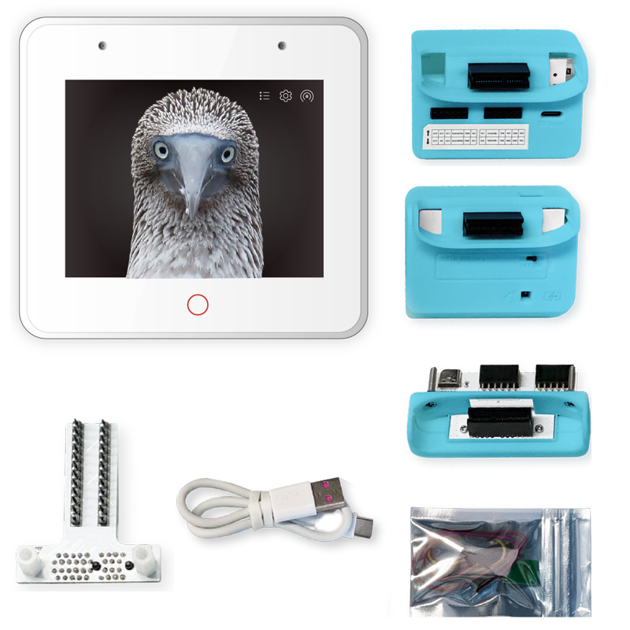
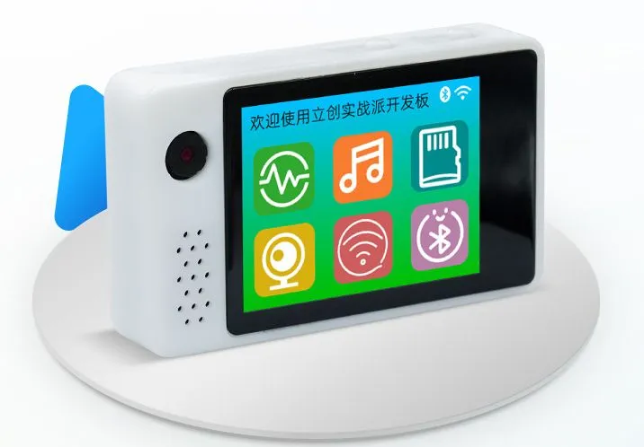
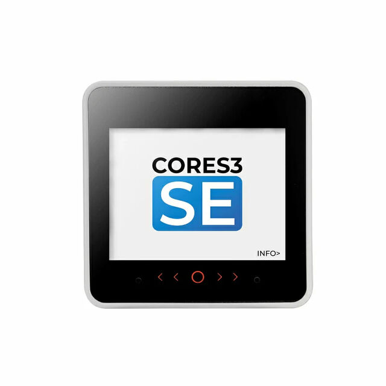
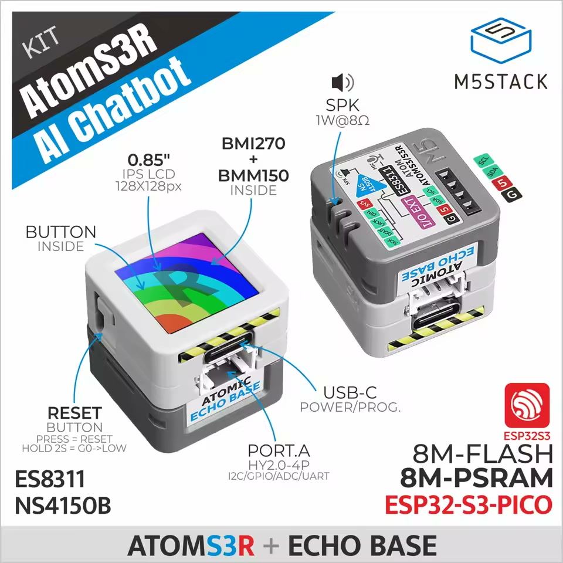
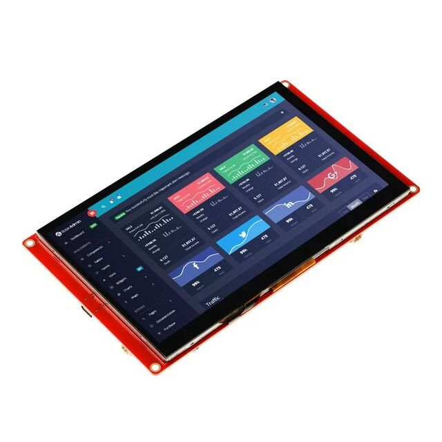

# Osiris board ports

Osiris uses the same voice, cloud, emoji and BOX1 host protocol on each board.
The first ports target ESP32-S3 hardware with PSRAM. These are Osiris images;
Xiaozhi firmware and its server account are not required.

| Hardware | PlatformIO environment | Display and controls | Memory layout |
| --- | --- | --- | --- |
| Espressif ESP32-S3-BOX-3 | `esp32s3box3` (default) | 320×240, GT911 touch; Settings / Switch | 16 MB flash, PSRAM |
| LiChuang 实战派 SZPI ESP32-S3 | `lichuang_s3` | ST7789 320×240, FT5x06 touch; hold BOOT 1.5 s for Settings | 16 MB flash, 8 MB octal PSRAM |
| M5Stack CoreS3 | `cores3` | 320×240, touch; Settings / Switch | 16 MB flash, 8 MB octal PSRAM |
| CrowPanel basic DIS08070H **with external INMP441** | `crowpanel7_inmp441` | 800×480 RGB, GT911 touch; Settings / Switch | 4 MB flash, 8 MB octal PSRAM; single app, no filesystem ([wiring](crowpanel7.md)) |
| M5Stack AtomS3R **with Atomic Echo Base** | `atoms3r_echo` | 128×128; hold front button 1.5 s for Settings; short click switches USB/Wi-Fi when both are available | 8 MB flash, 8 MB octal PSRAM; single application slot |

New ports require hardware validation. A successful build does not establish
microphone gain, speaker quality, touch alignment or board-revision compatibility.
All five environments have passed compilation. The 98 host regression tests,
cloud utility and SSE tests, M5 audio buffer checks and 32-bit I2S conversion/gain
checks also pass. No new board
has been flashed or physically tested during this port.
The original AtomS3, AtomS3 Lite, Atomic SPK Base, Atom Echo, Core2 and generic
ESP32-S3 boards are different hardware and must not use these images.

## Hardware photos

These product photos were supplied by the project maintainer. Displayed product
screens are illustrative, not screenshots of Osiris. Select firmware using the
exact board model and wiring above, rather than appearance alone.

### Espressif ESP32-S3-BOX-3



Environment: `esp32s3box3`. The photo shows the BOX-3 kit and accessories.

### LiChuang 实战派 ESP32-S3



Environment: `lichuang_s3`. Use the documented SZPI ESP32-S3 hardware revision.

### M5Stack CoreS3



Environment: `cores3`. **The supplied photo is labeled CoreS3 SE.** The existing
port targets CoreS3; SE compatibility has not been established by this photo or
by a hardware validation in this project.

### AtomS3R + Atomic Echo Base



Environment: `atoms3r_echo`. The photo includes the required **Atomic Echo Base**
for microphone and speaker audio; AtomS3R alone is not the supported voice setup.

### CrowPanel 7-inch + external INMP441



Environment: `crowpanel7_inmp441`. The picture shows the display, without the
required external **INMP441** microphone. This target uses the basic DIS08070H;
see the [microphone wiring and model details](crowpanel7.md).

## Build and flash

Choose the environment matching the exact product, for example:

```bash
pio run -e lichuang_s3
pio run -e lichuang_s3 --target upload --upload-port /dev/ttyACM0
pio device monitor -e lichuang_s3 --port /dev/ttyACM0 --baud 115200
```

Substitute `cores3`, `atoms3r_echo`, `crowpanel7_inmp441` or `esp32s3box3` as appropriate.
Read the [CrowPanel wiring and partition guide](crowpanel7.md) before using that target. For all ports:

```bash
pio run -e esp32s3box3 -e lichuang_s3 -e cores3 -e atoms3r_echo -e crowpanel7_inmp441
```

Each image is in `.pio/build/<environment>/firmware.bin`. This application-only
image belongs at **0x10000**, with its matching bootloader and partition table.
PlatformIO upload installs the correct components; use that for the first flash.
The generated `firmware.factory.bin`, when present, is a combined image for
**0x0**, not an interchangeable application image.

Flashing replaces Xiaozhi/other firmware. Save any original firmware and device
configuration needed for restoration before uploading. AtomS3R uses
`partitions/osiris_8MB.csv` to fit the bundled CJK fonts; it has no second OTA
application slot. Existing filesystem contents may not match the new layout.

## Controls and configuration

Wi-Fi failure opens a setup AP after 15 seconds. Its name starts with `BOX3`,
`LiChuangS3`, `CoreS3`, `AtomS3R`, or `CrowPanel7`, followed by `-Setup-XXXX`. The password is
`box3setup` for every board; the portal is at `192.168.4.1`.

Touchscreen boards use the existing bottom Settings and Switch buttons.
The bottom status bar is composed in an off-screen sprite and copied only when
its text/buttons change, avoiding the periodic clear-and-redraw flash on BOX-3's
SPI display. Under memory pressure it falls back to direct drawing on changes.
AtomS3R has no touchscreen: hold its front button for 1.5 seconds to open/close
Settings; use a phone/computer to enter Wi-Fi and provider settings. A short
click requests a transport switch only in host mode when USB and Wi-Fi are
both connected. A long press does not also request a transport switch.

The M5 ports retain the 320×240 logical UI, aspect-scaled and centered by
M5GFX. CoreS3 touch coordinates map back into that logical space. AtomS3R
text is small; use the serial monitor and web portal for detailed setup/errors.
Capture and playback alternate; these ports do not add acoustic echo cancellation.

All boards retain `host/box3.py` and its BOX1 protocol for compatibility. Host
variable/command names containing `BOX3` still apply to other supported boards.
Standalone OpenAI/Gemini and the experimental subscription adapter keep their
existing authentication and billing requirements.

## Drivers and validation

- BOX-3 retains its existing LovyanGFX panel, ES7210 microphone, ES8311 DAC and SD setup.
- LiChuang uses its SPI3 panel, shared I2C touch/codecs, ES7210 address **0x41**
  (upstream's 8-bit `0x82`), and PCA9557 LCD-reset/amplifier controls. Camera and
  SD are not enabled in this port; fonts and emoji are bundled in flash.
- CoreS3 and AtomS3R use pinned M5Unified/M5GFX dependencies for power, display,
  codec and I2S setup. Osiris does not install a second I2S driver on those boards.
  Capture uses two persistent buffers; playback uses three persistent buffers
  around M5Unified's retained-pointer playback queue.
- Startup stops with a serial diagnostic if PSRAM or display initialization fails.

On each physical board, check the boot diagnostics, touch orientation or button
hold/click behavior, setup AP, microphone WAV, speaker playback, sustained Wi-Fi
audio, USB/Wi-Fi switching, and a complete standalone cloud conversation. Test
at moderate speaker volume first and compare recorded WAV levels before changing
the speech threshold. These physical checks have not been run for the new ports.

Hardware-free audio-adapter checks:

```bash
g++ -std=c++17 -Wall -Wextra -Werror tests/test_m5_audio.cpp -o /tmp/osiris-m5-audio
/tmp/osiris-m5-audio
```

## Mini C3

Xiaoge Mini C3 is **not ported**. The current Osiris firmware depends on PSRAM
for 10-second recording, streamed playback and bounded cloud responses. A C3
port needs a separate memory/streaming design and a reduced display/feature
profile; selecting a different chip in PlatformIO is insufficient. There is no
Mini C3 environment or flash image in this revision.

## Hardware references

- [Xiaozhi LiChuang SZPI board definitions](https://github.com/78/xiaozhi-esp32/tree/main/main/boards/lckfb/szpi-esp32s3)
- [Xiaozhi CoreS3 board definitions](https://github.com/78/xiaozhi-esp32/tree/main/main/boards/m5stack/core-s3)
- [Xiaozhi AtomS3R + Echo Base board definitions](https://github.com/78/xiaozhi-esp32/tree/main/main/boards/m5stack/atoms3r-echo-base)
- [M5Unified driver source](https://github.com/m5stack/M5Unified)
- [CoreS3 hardware documentation](https://docs.m5stack.com/en/core/CoreS3)
- [AtomS3R hardware documentation](https://docs.m5stack.com/en/core/AtomS3R)
