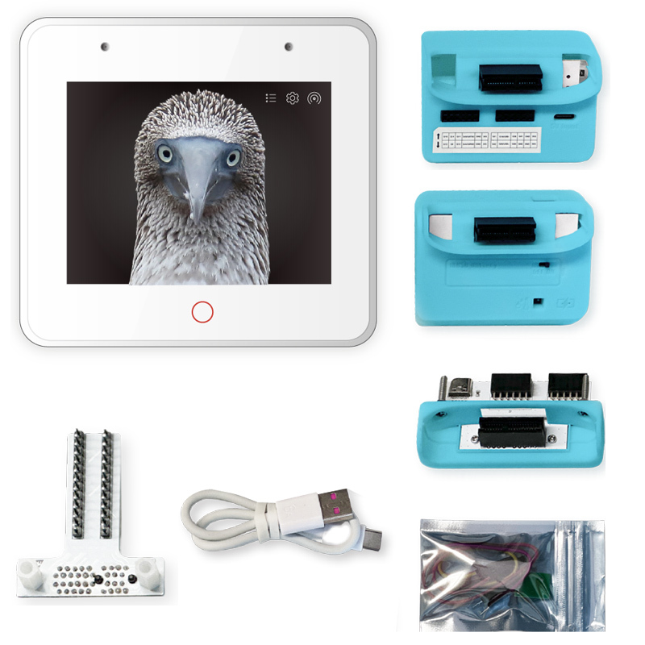

# USB / Wi-Fi bridge for the Pi coding-agent CLI

[](../docs/boards.md)

The host bridge also supports the other Osiris board targets. See the
[five-board photo guide, environments and required accessories](../docs/boards.md#hardware-photos).

For **standalone operation without Python**, use the firmware's Settings → Setup
page to select `openai` or `gemini` and save API/model settings. See the
[root README](../README.md#standalone-openai--gemini-voice--no-python-host).
This document describes the optional host-assisted mode; select `host` on the
device to use its USB/TCP bridge.


For Wi-Fi operation, flash the current firmware, configure Wi-Fi through the
BOX-3 **Settings** touchscreen button, and put the device and Pi CLI computer
on the same local network. Use the device IP shown on the display:

```bash
host/.venv/bin/python host/voice_agent.py --host 192.168.1.50 --language auto
# Or: export BOX3_HOST=192.168.1.50
host/.venv/bin/python host/box3.py --port socket://192.168.1.50:8233 status
```

TCP port 8233 carries the same BOX1 commands and audio as USB, so the speech
models, Pi CLI, and voice synthesis remain on the host. The host initiates the
connection to BOX-3; no inbound Pi host listener is required. Supply USB power
to BOX-3 without requiring a USB data connection. Use `--port /dev/ttyACM0`
to explicitly choose USB even when `BOX3_HOST` is set.

To enable switching during the same Pi conversation, supply both endpoints:

```bash
host/.venv/bin/python host/voice_agent.py --port /dev/ttyACM0 --host 192.168.1.50 --transport wifi
```

The display footer shows **Via: USB** or **Via: WiFi**, independently of Wi-Fi
network connection status. When both endpoints are configured and Wi-Fi is
connected, tap **Switch** beside Settings. A pending indicator remains until
the host switches at the next completed conversation/recording/playback boundary.
You can also type `/transport usb`, `/transport wifi`, or `/transport status` in
the host terminal. Only the selected transport is opened at a time. The Pi session
is preserved, and a failed switch attempts to restore the previous connection.
Both endpoints must refer to the same BOX-3. Switching requires updated firmware
advertising `link=1`; a single endpoint remains compatible with older firmware.
An endpoint being configured does not guarantee that its cable/network is reachable.
With no `--transport`, an explicit `--host` selects Wi-Fi, an explicit `--port`
selects that port, and environment defaults prefer `BOX3_HOST` over `BOX3_PORT`.

In the `host/voice_agent.py` console, use `/mic off` to pause microphone capture,
`/mic on` to resume, and `/mic status` to check its state. Keyboard prompts and
speaker playback remain available while the microphone is off. Commands take
effect after the current recording, recognition, or reply finishes; they do not
interrupt an active operation. This pauses host recording, without powering down
the microphone hardware. Restarting restores the default enabled state.
With `--keyboard-only`, microphone capture stays disabled; restart without that
option to enable it. These commands belong to voice mode, not the Pi tools console.

也可說或在終端輸入「把麥克風關掉」「關閉麥克風」「停止收音」，由主機直接
處理，不送給 Pi。「打開麥克風」「恢復收音」及「麥克風狀態」也可在終端輸入。
關閉收音後無法用語音重新開啟，請在終端輸入 `/mic on` 或「打開麥克風」。
語音控制仍須遵守喚醒詞規則；指令於目前收音／辨識完成後生效。

Use `/volume up` or `/volume down` in the voice agent console to change playback
volume by 10 percentage points. `/volume 50` sets 50%, `/volume 0` mutes playback,
and `/volume status` shows the level. The range is 0–100%, starting at 100%
(the existing playback level). This scales speech and music audio on the host;
it does not change microphone sensitivity or standalone firmware audio. Changes
apply to subsequent playback after the current operation finishes, survive
transport switches/reconnections, and reset when the voice agent restarts.
No firmware update is required.

中文也可直接說「大聲一點」「小聲一點」「音量調高」「音量調低」，
每次調整 10 個百分點；「靜音」設為 0%，「目前音量」顯示音量。
支援繁／簡體辨識結果，也可在終端輸入這些句子。啟用喚醒詞時，
須先喚醒或在後續對話時間內使用。指令由主機直接處理，音量顯示在
裝置螢幕和終端；一般包含這些字句的問答不會觸發調整。

### BOX-3 溫度／濕度查詢

需要 **ESP32-S3-BOX-3-SENSOR 感測器底座**，一般底座或 BOX-3 本體不提供此讀值。
硬體配置依據 [Espressif BOX-3 BSP](https://github.com/espressif/esp-bsp/blob/master/bsp/esp-box-3/include/bsp/esp-box-3.h)
與 [官方 Sensor Monitor 說明](https://documentation.espressif.com/esp-box/master/docs/getting_started.md)。
AHT30 使用獨立 I2C 匯流排（SDA GPIO41、SCL GPIO40、位址 0x38）；
讀值通過 CRC 檢查後才回傳，不使用 ESP32 晶片溫度代替室溫。

執行 `python3 configure.py`，選擇 `esp32s3box3`，再將 `BOX-3-SENSOR dock`
設為 YES，才可將 `Temperature / humidity` 設為 ON。兩者預設關閉；選擇無底座
或其他板型時，溫濕度功能自動關閉。儲存後重新編譯並燒錄才會生效，
也支援指令列：

```sh
python3 configure.py --env esp32s3box3 --sensor-dock on --environment-sensor on --save
python3 configure.py --action upload
```

然後在 voice agent 終端輸入 `/sensor`，
或說「現在幾度」「溫度多少」「濕度多少」「查詢溫濕度」。啟用喚醒詞時須先喚醒。
主機讀取即時感測值，並以中文顯示及朗讀攝氏溫度和相對濕度，不經過 Pi 模型。
沒有接底座、其他板型或韌體太舊時會提示無法讀取。
也可以關閉 voice agent 後單獨測試（同一連線只能由一個程式控制）：

```sh
host/.venv/bin/python host/box3.py --port /dev/ttyACM0 sensor
```

協定：`BOX1 SENSOR` 回覆 `BOX1 OK temperature_c=25.25 humidity_pct=63.50`；
失敗回覆 `BOX1 ERR sensor_missing`、`sensor_read`、`sensor_busy`、
`sensor_crc`、`sensor_uncalibrated`、`sensor_bus` 或 `sensor_unsupported`。
PING 的 `environment=1` 表示此韌體支援 BOX-3 底座查詢，並非底座已接上。
使用 Pi 工具模式時也可要求查詢，`pi/box3.ts` 的 `box3_environment` 工具
會透過相同連線讀取溫濕度。

### BOX-3 底座 18650 電池

在 `configure.py` 選 BOX-3 → `BOX-3-SENSOR dock: YES`，才可開啟
`18650 battery voltage / estimate`。預設關閉；選擇無底座或其他板型會自動關閉。
儲存、重新編譯並燒錄後，voice agent 可輸入 `/battery` 或說「電量多少」
「電池電壓」「有沒有裝電池」。Pi 工具模式提供 `box3_battery`。

```sh
python3 configure.py --env esp32s3box3 --sensor-dock on --battery-sensor on --save
python3 configure.py --action upload --port /dev/ttyACM0
# 關閉 voice agent 後，可單獨查詢
host/.venv/bin/python host/box3.py --port /dev/ttyACM0 battery
```

依 [官方 SENSOR-01 V1.1 電路圖](https://github.com/espressif/esp-box/blob/master/hardware/SCH_ESP32-S3-BOX-3_V1.0/SCH_ESP32-S3-BOX-3-SENSOR-01_V1.1_20230922.pdf)，
GPIO10 經 301kΩ／100kΩ 分壓量測電池端電壓。程式平均 16 次校準 ADC 讀值，
以粗略單節鋰電池電壓曲線估計百分比；不是電量計，充電、負載、電池老化和
ADC 誤差都會影響估計。電壓不在 2.5–4.3 V 範圍時不提供百分比。
沒有獨立電池插入或充電狀態輸入，因此兩者始終回報 `unknown`，不將低電壓
直接判定為沒裝電池，也不將充電器提供的電壓判定為一定有電池。
需在有／無電池及 USB／電池供電情境做實機比對後，再評估讀值準確度。

協定：`BOX1 BATTERY` 回覆
`BOX1 OK battery_mv=3800 percent_estimate=50 presence=unknown charging=unknown`。
`percent_estimate=-1` 表示無法估計；停用時回覆 `BOX1 ERR battery_disabled`。
PING 的 `battery=1` 僅表示韌體已啟用此功能。

Only one controller can own the audio buffers. While a TCP client is connected,
USB commands are discarded and additional TCP clients are rejected. Closing the
connection releases device buffers and returns control to USB. Restart the voice
agent after a dropped connection. TCP is unencrypted and unauthenticated: use a
trusted LAN and do not forward port 8233 to the internet.

The USB setup below and all speech/model installation steps still apply.


## Device and host setup

喚醒詞為 `Osiris` 時，主機也接受 Whisper 辨識成「奧西里斯」「歐西里斯」
及其簡體寫法。每次辨識出文字會在終端印出 `Heard:`；等待喚醒時沒有比對成功
會顯示 `Wake phrase not matched`。這仍是錄音後的 Whisper 辨識，並非即時喚醒引擎，
需要等待錄音和辨識完成。若顯示 `No speech recognized`，代表辨識沒有產生文字，
別名比對也無法觸發；可先測試錄音品質和語言選擇。
自訂別名可在 `voice_agent.py --setup` 的 `wake_aliases` 輸入逗號分隔文字，
或使用 `--wake-aliases '奧西里斯,小歐' --save-config`。明確指定的別名會取代預設別名。

未啟用 RuView 時，預設啟動即進入五分鐘對話狀態，不必先說喚醒詞；每次回覆完成後
重新計時五分鐘，逾時才回到等待喚醒。重新開啟麥克風也會開啟對話時間。
啟用 RuView 時仍等待喚醒詞／到達事件，預設回覆後對話時間為 30 秒。
已有設定檔的秒數會保留；要改為五分鐘可執行：

```sh
host/.venv/bin/python host/voice_agent.py --followup-timeout 300 --save-config
```

也可在 `--setup` 調整 `followup_timeout`（1–3600 秒）。
韌體回報 `emotion=llm moods=1` 時，等待下一句會保留最近一次 LLM emoji 表情，
尚未回覆則顯示中性表情，不顯示舊的耳朵圖示。收到合法 emoji 前綴時，
終端會印出 `LLM expression: mood_...` 以確認解析結果；Legacy 模式仍使用耳朵。
沒有 RuView 時，回覆失敗也會重新開啟對話時間，重複說喚醒詞不會縮短為 15 秒。

若 Pi 回報 `model context limit exceeded`，請檢查 LM Studio **實際載入**的 context
大小。Pi 的擴充工具與系統提示也會佔用 context；模型 metadata 宣告支援的最大值
不等於目前載入值。可在 LM Studio 增加 context 後重新載入模型，或暫用
`--pi-no-extensions` 排除擴充，但該次對話將無法使用那些擴充工具。

### 儲存 Pi 連線設定

`voice_agent.py` 也能直接儲存自己的啟動選項，設定一次後不必每次重打：

```sh
host/.venv/bin/python host/voice_agent.py --port /dev/ttyACM0 --language zh --save-config
# 下次直接啟動
host/.venv/bin/python host/voice_agent.py
```

`--save-config` 會驗證並儲存後退出，不連線或載入語音模型。可保存 USB／Wi-Fi、
provider、模型、語言、喚醒詞、收音模式及其他啟動選項；API 金鑰仍從環境變數讀取。
執行中輸入 `/config save` 也會儲存目前連線、音量及麥克風開關。
設定存於 `.voice-agent.json`（不提交 Git），下次自動載入。
命令列明確提供的選項優先；`--ignore-config` 可暫時忽略已存設定，
也可搭配 `--save-config` 用新的設定取代舊設定。

也可用互動設定精靈，不必記住完整參數：

```sh
host/.venv/bin/python host/voice_agent.py --setup
```

可設定連接埠、位址、語言（auto／zh／en）、provider、模型、喚醒詞、收音模式、
音量及 RuView MQTT。Enter 保留原值，`-` 清除選用欄位，完成後驗證並儲存退出。
`configure.py` 現在只管理韌體及硬體選項；主機選項集中在 `voice_agent.py`。
若尚無 `.voice-agent.json`，會讀取舊 `.host-connection.json` 的連線／語音模型設定
和 `.build-menu.json` 的語言／RuView 設定；執行 `--save-config` 或 `/config save`
即可整合保存。舊檔案保留，韌體儲存也不會刪除尚未搬移的舊主機欄位。
已有 `.voice-agent.json` 時以該檔為準，命令列選項可覆蓋。
語言選項控制語音辨識，變更後重啟主機即可，不需更新韌體。

舊 Pi 工具模式的精靈保留為相容入口：`python3 -m host.connection_setup --host-setup`，
其 `--host-start`／`--host-check` 也透過該模組執行，不再放在 `configure.py`。
主機 Python 環境由啟動命令選擇；Pi CLI 需在 PATH，請先完成下方依賴安裝及 Pi 登入。
裝置端須選 `host` 模式；Wi-Fi 連線須先設定裝置網路。

1. Upload the updated firmware using PlatformIO (`pio run --target upload`).
2. Connect the BOX-3's native USB data port to the Pi CLI host with a data cable.
3. Close PlatformIO Serial Monitor before using the bridge. Only one program
   should own the serial port. The bridge recognizes protocol replies separately
   from the existing volume logs.
4. Install the host dependency in a project environment:

```sh
python3 -m venv host/.venv
host/.venv/bin/pip install -r host/requirements.txt
export BOX3_PYTHON="$PWD/host/.venv/bin/python"
export BOX3_PORT=/dev/ttyACM0
```

Use the actual port on your machine. On Linux, you can inspect ports with
`host/.venv/bin/python -m serial.tools.list_ports`. The current host client uses
POSIX exclusive serial access and is intended for Linux/macOS.

```sh
"$BOX3_PYTHON" host/box3.py status
"$BOX3_PYTHON" host/box3.py display --language en -- 'Pi is ready!'
"$BOX3_PYTHON" host/box3.py display --language zh -- '你好 🤖 ✅'
"$BOX3_PYTHON" host/box3.py record /tmp/box3-mic.wav --seconds 5
"$BOX3_PYTHON" host/box3.py play /tmp/box3-mic.wav
"$BOX3_PYTHON" host/box3.py speaker-test
```

The status response reports `mic=1 speaker=1` when codec initialization succeeds.
That confirms register writes, not acoustic operation. The record/play round trip
is the first hardware audio check. Playback accepts mono, signed 16-bit PCM WAV
at 16000 Hz. Firmware reporting `stream=ring1` uses a ten-second PSRAM ring buffer,
prefills up to two seconds, then receives USB audio while I2S plays. This removes
the old ten-second upload/play pauses. Older firmware keeps segmented playback. Recording selects microphone channel 1 and lasts at most ten seconds.

`speaker-test` generates and plays a one-second 440 Hz tone without Pi or Piper.
If upload/playback completes but no tone is audible, the remaining fault is in
the device output path, not speech synthesis. Status should contain
`playback=usbfast-v2 rx=4096` after uploading the current firmware. This revision gives
USB transfers priority over blocking idle microphone reads, and sets the DAC
to unity digital gain. Microphone capture remains paused during playback.
The firmware reserves a 4096-byte USB RX queue before starting Serial; the
Arduino default is only 256 bytes and can discard long command lines. Hosts
use 256-byte audio payloads with offsets and CRC32 when the device advertises
`upload=checked1`. Failed integrity checks can be retried without duplicating
audio already received. Older firmware receives 64-byte legacy payloads, and
long text commands are paced in small writes. Upload the new firmware for the faster transfer path.

The voice agent announces listening once per waiting period, rather than every
two-second idle poll. It prints each reply's synthesis duration, audio upload progress,
playback start, and playback completion. Piper failures include their stderr;
speaker codec initialization failures are reported before uploading audio.
Playback completion means the device accepted/wrote PCM, not proof that the
physical speaker produced sound.

## Pi extension

### Local music in the standalone voice agent

Put audio files in `~/Music`, or choose a library with `--music-dir /path/to/music`.
Spoken requests such as `play song TITLE` and their Mandarin equivalents are
handled locally before Pi is called. The host matches the title against audio
filenames recursively, decodes the selected file to PCM with the installed mpv, and plays
it on BOX-3. Exact filename stems take priority. Missing tracks are reported;
multiple matches require a more specific filename. The default library matches the installed Pi jukebox extension's `~/Music`.
Use `--music-backend ffmpeg` to choose the older decoder. mpv uses PCM file
output, so the host bridge sends the audio to BOX-3. It does not invoke the
global jukebox extension or control its host-speaker IPC process. There is no
online song search or music-service integration. `/music /path/to/song.mp3` plays an explicit
local file. Playback is mono 16 kHz. Update the firmware for continuous USB streaming
(`stream=ring1` in status). USB stalls can still cause audible gaps. Listening resumes after the complete track finishes.

From the project directory:

```sh
pi -e ./pi/box3.ts
```

This extension targets the installed Pi CLI 1.2 API using `@earendil-works` imports.
It is explicitly loaded; it does not modify your global Pi configuration.

Pi receives these tools:

- `box3_display`: send text and supported emoji; choose en, zh, zh-TW, ja, or ko.
- `box3_say`: synthesize speech with the configured host adapter and play it.
- `box3_listen`: capture audio and return an English/Chinese transcript.

For example, ask Pi to use `box3_display` to show a short Chinese greeting with a
robot emoji. Display text occupies the upper 140 pixels; the volume meter remains
below it. Text beyond the visible area is clipped. Each request replaces the
previous message. There is no automatic mirroring or continuous listening.

`/box-listen en` or `/box-listen zh` records five seconds, transcribes it, and
submits the transcript as a new user message to Pi. Pi can then use the display
and speak tools for its reply. Recording occurs only on an explicit command or
tool call. Listening and playback are sequential; echo cancellation is not provided.

## Offline voice agent (Whisper, OpenCC, and Piper)

The pasted voice-agent script is adapted in `host/voice_agent.py`. It records
from the BOX-3 microphone and plays through the BOX-3 speaker, using the host for
Whisper recognition, OpenCC conversion, Piper synthesis, and Pi CLI requests.
The default is faster-whisper multilingual `small`, CPU int8, with automatic
language detection. Audio comes from BOX-3; NumPy normalizes its PCM samples.
Music decoding uses mpv. Recognition stays local after the model download.

Install the offline dependencies (plus the system `ffmpeg` executable):

```sh
python3 -m venv host/.venv
host/.venv/bin/pip install -r host/requirements-offline.txt
export BOX3_PYTHON="$PWD/host/.venv/bin/python"
export BOX3_PORT=/dev/ttyACM0
```

Whisper downloads into `.cache/voice-models/whisper` on first use and loads
from that cache on subsequent runs. Select another multilingual model or local
CTranslate2 model directory with `--whisper-model` / `BOX3_WHISPER_MODEL`.
Avoid `.en` models for mixed-language recognition.

Piper and optional legacy Vosk models default to `~/aion-voice/models`
(override with `BOX3_MODELS_DIR`):

| Component | Default path | Override |
| --- | --- | --- |
| Chinese Vosk | `vosk-cn/` | `BOX3_VOSK_ZH` |
| English Vosk | `vosk-en/` | `BOX3_VOSK_EN` |
| Chinese Piper | `zh_TW-huayan-medium.onnx` | `BOX3_PIPER_ZH` |
| English Piper | `en_US-lessac-medium.onnx` | `BOX3_PIPER_EN` |

Each Piper ONNX model also needs its matching `.onnx.json` file. Models are not
included in this repository. For the optional Vosk backend, use an English model from the
[Vosk model catalog](https://alphacephei.com/vosk/models), extract it, and point
`BOX3_VOSK_EN` at the extracted folder. Chinese recognition is converted to
Traditional Chinese with Taiwan terminology; English word spacing is preserved.

In this workspace, the host environment is installed and the small English
model has been downloaded to `.cache/voice-models/vosk-model-small-en-us-0.15`.
The adapter uses that cache automatically when the default `vosk-en` folder is
absent and `BOX3_VOSK_EN` is unset. This ignored cache is local setup data; a new
checkout needs its own model download or an explicit model path.

```sh
"$BOX3_PYTHON" host/voice_agent.py --language auto
"$BOX3_PYTHON" host/voice_agent.py --language zh
"$BOX3_PYTHON" host/voice_agent.py --stt-backend vosk --language en
"$BOX3_PYTHON" host/voice_agent.py --keyboard-only
```

Use `--language auto` (the default) for Chinese/English and mixed utterances.
`--language zh` or `en` supplies a language hint rather than selecting another
Whisper model. Short utterances and song titles can still be misrecognized.
Vosk remains available with `--stt-backend vosk` and a fixed language. Replies containing Chinese use the Chinese display font. Speech selects the
Chinese or English Piper voice per language run, preserving mixed text order. The agent asks Pi for concise conversational replies
in Traditional Chinese or English. Pi runs with `--print --thinking off`, loads configured Pi extensions, and uses a
session file shared across turns for the lifetime of this process. The session
is temporary and removed when the voice agent exits. This standalone runner owns
the serial port; do not run the serial Pi extension concurrently.

Voice capture now defaults to `--capture-mode auto`: the BOX-3 continuously
reads microphone audio while waiting for speech, preserves 256 ms of pre-roll,
starts after 48 ms above the amplitude threshold, and finishes after a pause.
The default pause is one second; adjust with `--silence 1.5` if you pause while
forming sentences. The default amplitude threshold is 80; increase it with
`--threshold 150` in a noisy room or reduce it for quieter speech. This is
amplitude-based endpointing, not a neural speech detector.

Upload the current firmware first. Status must include `vad=1`. A command waits
up to two seconds for speech onset and repeats when idle. Once speech starts,
the device records continuously until the pause or the ten-second buffer limit,
including pre-roll and trailing silence. Transfers happen after endpointing,
not between 250 ms slices of the utterance. The keyboard queue is checked
between commands; it cannot interrupt a recording already in progress.

```sh
host/.venv/bin/python host/voice_agent.py --port /dev/ttyACM0 --language zh
host/.venv/bin/python host/voice_agent.py --port /dev/ttyACM0 --language zh --silence 1.5
```

Use `--capture-mode window --record-seconds 4` for fixed recordings if needed.
For diagnosis, add `--save-recording /tmp/box3-last.wav`; it saves and overwrites
the latest recognized capture at that path. Terminal diagnostics show amplitude,
duration, and empty recognition results. Use Whisper `--language auto` for mixed speech, or a language hint if
automatic detection is unreliable. Experimental
`--capture-mode vad` retains the old host-side detector with gapped USB batches;
device-side `auto` is preferred.

Keyboard prompts are accepted in a bounded background queue. Listening pauses
while Pi is processing and while speech/music plays, then discards a short audio
batch before resuming. `/quit` exits this application. `/music PATH` converts an
audio file with the selected decoder and plays it on BOX-3. Other text is sent to Pi normally;
there is no host shutdown shortcut. Current firmware streams long tracks; older firmware uses ten-second segments. After each utterance is recognized, its complete text
appears as `You:` in the terminal and on the BOX-3 with a `You / Pi replying`
label. Keyboard prompts use the same path. Recognition is shown after the
utterance finishes; this is not a live partial transcript.

Final Pi replies appear as `Pi:` in the terminal. The BOX-3 shows the same reply
in numbered pages in the upper 140 pixels, with each page displayed while its
speech is synthesized and played. Long replies are no longer cut to 160
characters. Long user transcripts are also paged, with a two-second pause before
advancing; the last transcript page remains visible while Pi is working. The
last reply page remains visible afterward. English words wrap when possible;
Chinese characters and supported emoji wrap within the display width. Emoji
are displayed but omitted from Piper input. Replies appear when Pi finishes
generating them; token-by-token LLM streaming is not provided.

## Speech tools and optional external adapters

`box3.py listen` and `box3.py say` now default to `offline_speech.py`, using the
same model paths above. The Pi extension's listen/say tools use those defaults.
Set `BOX3_PYTHON` to an environment with the offline packages before starting Pi.

```sh
"$BOX3_PYTHON" host/box3.py listen --language zh --seconds 5
"$BOX3_PYTHON" host/box3.py say --language en -- 'Hello from Pi'
pi -e ./pi/box3.ts
```

For another engine or a cloud service, override the adapters with JSON arrays
of executable arguments (these example executables must be supplied by you):

```sh
export BOX3_STT_COMMAND='["/path/to/transcribe", "--input", "{input}", "--language", "{language}"]'
export BOX3_TTS_COMMAND='["/path/to/synthesize", "--text-file", "{text_file}", "--output", "{output}", "--language", "{language}"]'
```

STT receives a 16 kHz mono PCM16 WAV file and `en` or `zh`; stdout must contain
only the recognized UTF-8 text. TTS reads a UTF-8 text file and writes a 16 kHz
mono PCM16 WAV. Diagnostics belong on stderr. External commands must finish
within 180 seconds and exit zero on success. Text never passes through a shell.
The standalone voice agent uses the offline engine directly, not these overrides.

## Protocol v1

ASCII lines end in LF. Requests begin `BOX1 `; text and PCM payloads use hex.
Requests are sequential, acknowledged by `BOX1 OK`, or fail with `BOX1 ERR reason`.

| Request | Behavior |
| --- | --- |
| `PING` | Return codec readiness, sample rate, and capabilities including `audio=pull1` and `wake=1` |
| `WAKE` | Read the saved wake phrase as `wake_hex=<hex UTF-8>` (maximum 96 decoded bytes); no credentials are returned |
| `TEXT <language> <hex UTF-8>` | Replace the upper display message (1024-byte limit) |
| `RECORD <byte-count>` | Capture and retain PCM; acknowledge actual bytes, expected bytes, partial flag, elapsed time, and read error |
| `LISTEN <threshold> <silence-ms> <wait-ms>` | Capture a variable utterance on-device; zero bytes means no onset before timeout |
| `READ <offset>` | Read up to 256 retained PCM bytes; emit DATA lines and OK with offset, length, and CRC32 |
| `PLAY <byte-count>` | Allocate a playback buffer (up to 320000 bytes) |
| `CHUNK <offset> <crc32-hex> <hex PCM>` | Commit up to 256 PCM bytes after validation; acknowledge `next=<offset>`; identical retries are safe |
| `DATA <hex PCM>` | Append up to 512 bytes; wait for OK before the next chunk |
| `END` | Play the complete buffer and acknowledge completion |
| `CANCEL` | Release playback/recording buffers and disable the amplifier |

PCM is little-endian mono at 16000 Hz. Byte counts must be positive and even.
Lines are limited to 2200 bytes. Abandoned playback uploads expire after 15 seconds.
Retained recordings expire after 30 seconds without a read. The host requests
each recorded block sequentially and checks its offset, byte count, and CRC32;
damaged blocks with a completed reply are retried up to three times. A missing
terminal reply stops the operation to avoid mixing responses. Recordings are no
longer pushed in one unchecked burst. Upload the matching firmware before using
the updated host client; older firmware is rejected with an explicit message.
There are no request IDs: one host operation may be active at a time. Native USB
is required for this version; a 115200-baud UART adapter is not the intended path.

## Validation

If the host reports `Malformed audio response`, upload the latest firmware and
close other serial clients before retrying. Audio replies now use short packets
and check partial USB writes. The host drains a damaged reply before reporting
the error, and includes the line length and a bounded prefix for diagnosis.
Invalid audio is rejected rather than passed to the recognizer.

After uploading, verify the protocol before starting the voice agent:

```sh
host/.venv/bin/python host/box3.py --port /dev/ttyACM0 status
host/.venv/bin/python host/box3.py --port /dev/ttyACM0 record /tmp/box3-check.wav --seconds 1
```

Status must contain `audio=pull1`. A successful one-second recording is a mono
16000-frame PCM16 WAV. Missing data reports the block offset and actual/expected
byte counts rather than a generic incomplete-recording message.

The display meter uses the same microphone samples in idle and USB recording
mode. During a recording it refreshes about every 50 ms and labels the level
`Recording`, even though the USB recording handler is synchronous. It does not
perform extra microphone reads that would remove samples from the recording.

The microphone configuration revision also reports `capture=slot32-v3` in
status. It uses 16-bit PCM data in explicit 32-bit I2S slots on both RX and TX,
the complete Espressif ES7210 power/reset sequence, and register readback during
initialization. Both channel clocks are recalculated after the slot width is
changed; retaining the earlier clock divider can halve the actual sample rate.
Re-upload firmware to apply this configuration.

Temporary I2S timeouts are retried within the bounded capture deadline, and
valid bytes from partial driver reads are retained. If the deadline expires
after capturing some audio, the diagnostic `record` command saves the shorter
WAV and exits with an explicit partial-recording warning, including actual and
expected byte counts. Recognition still rejects incomplete audio. A capture
that produces no audio cannot create a meaningful WAV and remains an error.

The supplied eight-second Mandarin recording exposed a repeating pattern:
only sample positions 9 and 10 of every 16 carried nonzero audio; all other
positions were zero. Peak amplitude was 6209 with no clipping. This is evidence
of a capture/framing problem, not a reason to increase gain. The host now detects
this specific pattern and reports a capture fault before running speech recognition. New
hardware recordings are needed to validate the revised configuration; the old
recording cannot demonstrate that the firmware change works.

```sh
python3 -m unittest discover -s tests -p 'test_*.py'
pio run
```

Protocol tests use a simulated serial device. Firmware compilation and extension
loading do not replace hardware tests of the USB link, microphone, or speaker.

Continuous playback firmware update:

```sh
/home/john/.platformio/penv/bin/pio run -t upload --upload-port /dev/ttyACM0
host/.venv/bin/python host/box3.py --port /dev/ttyACM0 status
```

Stop the voice agent before uploading. Confirm `stream=ring1`, then restart it.
The host decodes the complete track before streaming; music playback still pauses
voice recognition. This implements continuous playback within a track, not a playlist
or microphone interruption during playback.

Stream revision 2 (`streamrev=2` in status) keeps the ring buffer alive while
streaming. The worker detects 60 seconds without audio progress; the legacy
15-second upload cleanup only applies to non-streaming playback. Buffer errors
include the device buffer state and host audio offset to distinguish expired
uploads from size mismatches. Prefill timeout resets whenever more audio arrives.

Stream revision 3 (`streamrev=3`) returns `stream_busy` immediately when its ring
is full; the host retries the same uncommitted block for up to five seconds.
I2S writes use a bounded driver call. A timed-out host stops accepting unrelated
commands until a unique `RESET token` / `OK sync=token` barrier drains old replies
and cancels playback. If recovery fails, recognition cannot resume on that link.

Stream revision 4 (`streamrev=4 sync=1`) supports non-destructive `SYNC token`.
Streaming uses 128-byte audio blocks. If a CHUNK reply is missing for two seconds,
the host terminates any partial USB line, waits for the unique sync reply, verifies
the device offset, and retries the same block (up to three transmission attempts).
This handles both a lost request and a lost acknowledgement without restarting
the track. Repeated failures still cancel playback; a stall can remain audible.
Startup prints the firmware status and timeout errors include the audio offset.

The `face=1` capability enables a large Pi robot expression in a 100-pixel left
column. Conversation text occupies the right column (208 pixels, six body rows
per page plus a speaker label); the existing microphone meter stays below.
`FACE happy|sad|listening|thinking|speaking|music|error` changes only the avatar.
The voice agent shows listening, thinking, speaking, music and error states.
Listening and recognition updates preserve the last dialogue page. These are
static state expressions, not inferred LLM emotions or lip synchronization.

The voice agent keeps one Pi RPC process alive across requests and prepares
configured Piper voices before listening. `--pi-one-shot` uses a separate Pi
JSON CLI process for each request; `--no-tts-warmup` loads voices on first use.
Use these flags for compatibility or timing comparisons. See
[voice latency](../docs/voice-latency.md) for measurements and limitations.

Pi extensions are enabled by default so configured weather/web tools can be used
from BOX-3 conversations. `--pi-no-extensions` restores isolated operation for
troubleshooting. The Pi subprocess excludes `box3_*`, `get_room_temperature`,
and `jukebox_control`: the voice host owns the serial port and music playback.
The locally installed room-temperature extension hardcodes `/dev/ttyACM0`; it
is a separate sensor reader, not an outdoor weather service. Extension startup
hooks still run, so extensions must not open the BOX-3 port in startup hooks.

Piper synthesis now supports mixed Chinese/English replies: Chinese characters
use the Chinese voice and Latin words use the English voice. Consecutive runs
retain spaces, numbers, and punctuation. Each run is rendered to mono PCM16 at
16 kHz, then joined into one WAV before playback. The voices have different
timbres; this is not a single bilingual voice. Several language switches require
more preparation time because each run starts a Piper process.
To test a saved BOX-3 recording without starting Pi or using the serial port:

```sh
host/.venv/bin/python host/offline_speech.py stt --input /tmp/box3-mandarin-new.wav --language auto
```

See the [faster-whisper documentation](https://github.com/SYSTRAN/faster-whisper)
for model and CPU inference details.

Mixed-speech smoke test generated `/tmp/box3-bilingual-reply.wav` from Chinese,
English, and Chinese runs using the installed voices. The 4.11-second WAV took
about 6 seconds to prepare on this host. Actual timings depend on text and CPU.


### Wi-Fi audio latency

Update both firmware and `host/box3.py` for the optimized TCP transport. The
host reads TCP replies in batches with TCP_NODELAY, and firmware advertises
`netchunk=8192 netread=4096` over Wi-Fi to negotiate larger checked playback
blocks and `READ offset count` recording downloads. USB retains its existing
block sizes; firmware also accepts legacy `READ offset` requests.
Wi-Fi playback starts after 500 ms of audio is buffered (USB retains a two-second
prefill), and ESP32 Wi-Fi power saving is disabled during operation. CRC checks,
retry handling, and stream backpressure remain enabled. These changes reduce
transport overhead; speech recognition, Pi response generation, and synthesis
still contribute to total conversational latency.

For continuous Wi-Fi playback, the host now sends up to 8192 PCM bytes per
acknowledgement (256 ms of audio), rather than acknowledging every 32 ms.
The half-second prefill absorbs ordinary Wi-Fi jitter. At completion, diagnostics
print `Audio supply: underruns=N, stalled_ms=M`. Nonzero values mean the playback
worker ran out of queued audio; these measure buffer starvation, not STT/Pi/TTS
time. Update firmware and host together to negotiate these sizes. For an isolated
transport/speaker check without speech models or Pi, run:

```bash
host/.venv/bin/python host/box3.py --port socket://192.168.1.50:8233 speaker-test
```

Use the device's actual IP and close the voice agent before this diagnostic.

The device also reads incoming commands in 512-byte batches and polls Settings
touch input at 50 Hz. This avoids a socket availability query and an I2C touch
poll for every received byte/loop, while preserving fragmented commands, USB
framing, frame limits, and the existing 500 ms Wi-Fi prefill.


## Configurable wake phrase

Spoken requests require the device's saved wake phrase (default **Osiris**)
over USB or Wi-Fi. Change **Settings → Setup → Wake phrase** on the device,
save, and exit Settings. The updated host checks for changes between listening
turns; changing the phrase resets its current follow-up window. Blank in the
portal restores `Osiris`. The setting persists across device restarts.

`--wake-word 'Hey Nova'` overrides that setting for one host run. Older firmware
without `wake=1` capability keeps the default `Osiris`; `--no-wake-word` disables
host gating. Recognition uses transcription, not a trained local wake model.

With the default phrase:

- Say **“Osiris, what is the weather?”** in one utterance, or
- Say **“Osiris!”**, wait for **Awake!** on the display, then speak one request
  within **15 seconds**.

After each completed answer, the agent stays awake for **30 seconds** so you
can ask a follow-up without repeating “Osiris!”. Each completed reply starts a
fresh 30-second window. If the window expires, the sleeping emoji returns and
the wake phrase is required again. The standalone wake still allows 15 seconds
for the first request. Unrelated speech is ignored while asleep. Keyboard prompts and `/transport` commands do not need a wake phrase.
The spelling is **Osiris**; matching ignores case and does not require the
exclamation mark.

```bash
host/.venv/bin/python host/voice_agent.py --host 192.168.1.50 --language auto
# Optional: change initial/follow-up timeouts, keyword, or disable wake gating
host/.venv/bin/python host/voice_agent.py --host 192.168.1.50 --followup-timeout 30
host/.venv/bin/python host/voice_agent.py --host 192.168.1.50 --wake-timeout 20
host/.venv/bin/python host/voice_agent.py --host 192.168.1.50 --wake-word 'Hey Osiris'
host/.venv/bin/python host/voice_agent.py --host 192.168.1.50 --no-wake-word
```

Wake detection uses the existing host speech-to-text transcript, rather than a
separate trained keyword model. Audio still travels to the host and is recognized
while waiting; requests only go to Pi after the wake phrase matches. Recognition
accuracy and wake response time depend on the speech model and language setting;
`--language auto` allows the English wake phrase with Chinese or English requests.
It listens between requests, and remains paused during Pi processing and speaker
playback. A CLI-only phrase override works with older firmware; sharing the
device Settings value requires the updated firmware and host script.


### Additional emoji expressions

`Box3.expression(state)` and `BOX1 FACE state` now also support `sleeping` 😴,
`waiting` ⌛, `surprised` 😮, `love` 🥰, `success` 🎉, and `warning` ⚠️.
The voice agent automatically shows sleeping while waiting for the wake word,
and listening after waking. New firmware advertises `emojistates=1`; the Python
client uses compatible older expressions if that capability is absent.
The same artwork is included in the supported inline emoji set at 16×16.

## Reply providers: Pi, OpenAI, and Gemini

Pi remains the default. The standalone voice agent can also request text replies
from OpenAI or Gemini directly, without installing or launching Pi CLI. Speech
recognition, wake gating, synthesis, music decoding, and device transport still
run on the host. The 30-second follow-up window applies to every provider.

| Provider | Startup option | Host credential | Model configuration |
| --- | --- | --- | --- |
| Pi CLI | `--provider pi` (default) | Existing Pi configuration | Existing Pi configuration |
| OpenAI | `--provider openai` | `OPENAI_API_KEY` | `--model` or `BOX3_OPENAI_MODEL` |
| Gemini | `--provider gemini` | `GEMINI_API_KEY` | `--model` or `BOX3_GEMINI_MODEL` |

Choose a model ID available to your API account. No cloud model is hardcoded.
Set the relevant key in your host environment, then start one provider:

```bash
# OpenAI — replace both placeholders with your own values.
export OPENAI_API_KEY='YOUR_OPENAI_API_KEY'
export BOX3_OPENAI_MODEL='YOUR_OPENAI_MODEL_ID'
host/.venv/bin/python host/voice_agent.py --host 192.168.1.50 --provider openai

# Gemini — use this instead to select Gemini.
export GEMINI_API_KEY='YOUR_GEMINI_API_KEY'
export BOX3_GEMINI_MODEL='YOUR_GEMINI_MODEL_ID'
host/.venv/bin/python host/voice_agent.py --host 192.168.1.50 --provider gemini
```

Use your actual BOX-3 IP, or replace `--host` with `--port /dev/ttyACM0` for USB.
An explicit `--model MODEL_ID` overrides the selected provider's model environment
variable. For keyboard prompts, add `--keyboard-only`; speech playback still uses
the existing local voices. No extra Python SDK or firmware update is required.

The terminal identifies the selected provider and model, and cloud replies are
labeled OpenAI or Gemini on the display. Cloud conversations retain the most
recent 12 completed turns in host memory and reset when the process restarts.
Switching USB/Wi-Fi does not reset that history. Failed, blocked, or empty
responses do not add a turn.

Direct cloud providers return conversational text; they do not receive Pi's
coding tools, filesystem access, or web/weather tools. Explicit `/music` and
supported local song requests continue to be handled by the host. Cloud mode
sends recognized request text and recent conversation history to the selected
provider over HTTPS, and requires internet access and an API account with model
access/quota. API keys stay in the host environment and are not sent to BOX-3.
Keep real credentials out of committed files. STT/TTS audio is still processed
locally by the existing pipeline.

The adapters use OpenAI's [Responses API](https://developers.openai.com/api/docs/guides/text)
and Gemini's [Generate Content API](https://ai.google.dev/gemini-api/docs/generate-content/text-generation).
For HTTP authentication, model-access, quota, or rate-limit errors, check the
selected API account and model ID. No live cloud calls are made by the tests.

## ESP32 subscription prototype

The firmware's experimental `chatgpt` mode imports app/device-specific OAuth
credentials for text inference and uses a separate OpenAI API key for speech.
It runs without this Python host at runtime, but does not implement first-time
account login on ESP32. See the [prototype setup and limitations](../README.md#experimental-chatgpt-subscription-adapter).
Gemini subscription-account login is not implemented; its API mode remains available.

## RuView presence wake

Optional MQTT presence events can wake the host voice agent for a spoken request.
See [RuView setup, behavior and validation limits](../docs/ruview.md).
